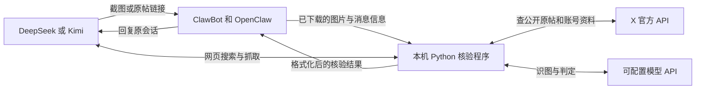

# X Validator 微信截图核验设计

## 首版交付

在个人微信的 ClawBot 私聊里发一张 X 截图，X Validator 自动在同一会话回复原帖比对、账号可信度和独立事实核验。候选帖只展示排名第一条的截图，独立事实核验显示来源名称。可以补发原帖链接，也可以追问上一条结果的来源。日常使用从微信完成。

首版部署在当前 Windows 电脑上，每条消息处理一张中文或英文的 X 截图，原帖链接可选。本机已实测微信收图和结果回传、X 按链接读取和按日期检索历史帖，以及从截图识别到独立事实核验的流程。

## 消息和数据怎么走

**微信接入。** 使用腾讯维护的 ClawBot 通道，扫码绑定个人微信。OpenClaw 2026.11.7 通过 `reply_dispatch` 向接入插件交付包含媒体路径的消息上下文。插件只从当前网关的媒体目录中取图，通过标准输入把附件路径和消息文字以 JSON 交给固定的 Python 入口。接入层使用会话和消息标识管理追问与去重，Python 返回结构化结论和最终文本，由 OpenClaw 的原会话发送器回复。 [OpenClaw 微信通道](https://docs.openclaw.ai/channels/weixin) · [入站与回复接口](https://docs.openclaw.ai/plugins/hooks/messages)

**截图识别。** 首版拟用 DeepSeek Flash，把截图里的 `@用户名`、可见正文、可见时间和可核验说法提取成结构化数据。程序校验返回值，区分主帖、引用帖和回复。看不清的字段留空，需要更多信息时请用户补原链接或清晰截图。图片里的文字、网页内容和帖子正文一律作为数据处理。 [DeepSeek 图像理解](https://api-docs.deepseek.com/zh-cn/guides/vision/)

**原帖查询与比对。** 复用 `x_validator.py` 的 `XClient`。有链接就提取帖子 ID 后直接读取。截图可读出完整日期和钟点时，优先按账号查这个时刻前后五分钟的帖子。短语和时间检索可以互为补充。只有译文时，以账号和时间查找候选。程序在本机比对账号、可见文字和时间，保留编辑版本信息。 [按 ID 查帖](https://docs.x.com/x-api/posts/get-post-by-id) · [编辑版本说明](https://docs.x.com/x-api/posts/lookup/integrate) · [X 搜索范围](https://docs.x.com/x-api/posts/search/introduction)

**账号可信度。** 优先评估截图显示的完整 `@账号`，只有链接时采用 X 返回的作者账号。复用查帖返回的同名作者资料，缺失时按用户名查询。展示 X 认证类型、戏仿标记、注册时间、关注者数量和自填简介。抓取主页所填网站核对是否回链，或搜索包含该账号链接的外部网页。结论反映可核对的身份和背景线索，历史发帖准确率需要另外取证。站外查询仅发送目标网址或公开用户名。 [X 账号查询](https://docs.x.com/x-api/users/get-user-by-username) · [X 认证与账号标记](https://help.x.com/en/rules-and-policies/profile-labels)

**独立事实核验。** 后端默认用 DeepSeek Search 和 Fetch 查找证据、读取正文，也可用 Kimi Web Search Basic 和 URL Fetch。优先查看当事机构原文、原始记录和有独立采证的报道。同一稿源的多篇转载按一份证据计算。模型只根据实际获取的材料评估截图中的说法，并返回所用证据的编号。程序检查引用片段能否在已获取的正文中找到。原帖无法确认时，有可辨认的事实说法仍继续查证。 [DeepSeek 网页工具](https://api-docs.deepseek.com/zh-cn/guides/search/) · [Kimi 网页工具](https://platform.kimi.ai/docs/api/tools-search)

**模型分工。** 默认用 DeepSeek Flash 识图和初判，有可读材料且初判需要复核时，每条说法最多加一次 DeepSeek Pro 文字复核。程序校对两轮引用，证据结论互相冲突时保留证据不足。困难截图用视觉模型定向复读，默认是原图细节的 Flash。两条模型路线可分别配置厂商、Key、地址和模型。网页取证接口单独选择。程序按厂商的 Chat Completions 协议设置 JSON 输出与令牌限额。

## 微信里的结论

| 项目 | 可能返回的结论 | 判断条件 |
| --- | --- | --- |
| 原帖 | 已匹配，截图可见部分一致 | 找到明确原帖，账号和可见正文一致；可解析时间也一致时一并说明。 |
| 原帖 | 找到候选，暂无法确认 | 有相似结果，但截图太短、时间含糊或存在多个合理候选。 |
| 原帖 | 找到原帖，存在差异 | 有可定位的原帖，能指出具体差异。原帖有编辑版本时，标明与哪个版本比对。 |
| 原帖 | 暂无法确认 | 找不到、无法访问、截图信息不足，或 X 查询失败。回复会标明遇到的情况。 |
| 账号 | 有 X 平台身份线索 / 与所填网站互链 / 戏仿类账号 / 可信度证据有限 / 资料不足 | 金标、灰标、X 身份验证和网站互链提供不同身份线索。有戏仿标记时优先显示。蓝标、账号年龄和关注者数作为背景。 |
| 单条说法 | 有证据支持 / 有证据反驳 / 证据不足 | 每条说法附一句理由和所用来源。只有摘要、证据冲突或找不到可核实的材料时，给出证据不足。 |
| 贴文 | 证据支持度及覆盖率 | 对本次最多三条主要事实等权计算。支持条数除以总条数给出下界，支持加待核实条数除以总条数给出上界。有结论的条数除以总条数给出覆盖率。全部说法待核实时显示暂无法评估。 |

程序取排名第一的候选 ID，在独立的后台 Chrome 或 Edge 中打开 X 官方嵌入页，核对页面中的帖子 ID 后截取帖子区域，作为微信图片回复。微信发送完成后清理临时截图。页面未渲染出对应帖子时，回复注明截图不可用并附候选正文节选。

截图裁剪时只确认可见范围。图片里只有观点或缺少可核验的说法时，事实核验项会说明原因。以同一会话最近一次结果为上下文，支持「原帖在哪」「证据出处是什么」和补发原链接。结果在内存保留 30 分钟，过期后请用户重发截图或链接。

## 运行和费用

- **本机运行。** OpenClaw 和 Python 核验程序先放在同一台 Windows 电脑，使用本机进程交接。手机可以直接发图，电脑和网关需要保持在线。当前交互式 Python 已通过 Windows 系统代理接通 X，网关启动的实际进程也要验证网络路径。 [OpenClaw Windows 部署](https://docs.openclaw.ai/platforms/windows)
- **需要配置的凭证。** X App-only Bearer Token 用于查原帖。默认以同一个 `DEEPSEEK_API_KEY` 完成识图、初判、复核和网页取证，也可分别配置。ClawBot 在手机微信扫码授权。凭证由本机运行环境按需注入，日志只留任务标识、耗时和错误类型。识图服务接收截图，证据判定服务接收待核验说法和证据片段，网页取证服务接收检索词与待抓取 URL。X API 返回的帖子在本地比对。临时工作副本在处理后清理，网关的媒体缓存和会话保留策略在部署时核对。
- **控制每次查询。** 每个请求最多发出两次 X 搜索，每次最多取 10 条候选。事实核验先查最多 3 条主要说法，每条最多读取 2 个候选来源。按会话和消息标识合并重复请求。遇到额度不足、限流或超时，在当次回复里给出已完成的部分和无法完成的原因。 [X API 计费](https://docs.x.com/x-api/getting-started/pricing) · [DeepSeek 搜索与抓取计费](https://api-docs.deepseek.com/zh-cn/guides/search/#计费)
- **账号评估的增量。** 最多一次 X 账号读取和一次网页搜索或抓取。补发链接时，复用同一 `@账号` 已取得的评估。用量按所选服务计费。 [X API 计费](https://docs.x.com/x-api/getting-started/pricing) · [DeepSeek 搜索与抓取计费](https://api-docs.deepseek.com/zh-cn/guides/search/#计费)

## 实现顺序和验收

| 顺序 | 实现 | 验收 |
| --- | --- | --- |
| 1 | 验证微信收发；让插件收到授权私聊的图片后回一条固定文本。 | 手机发图，电脑收到有效媒体文件，原会话只收到一条回复。 |
| 2 | 接视觉识别与现有 `XClient`，实现候选匹配和原帖比对。 | 实测带链接、仅截图、历史帖子、裁剪图以及改字截图。明确区分匹配、候选、差异和暂无法确认。 |
| 3 | 接独立搜索、证据读取和微信结果模板。 | 用有公开证据的样例验证支持与反驳，用证据稀少的样例验证证据不足。核对回复列出的来源是否支持对应结论。 |
| 4 | 联调补链接、追问、等待超时和额度错误，确认启动方式。 | 连发两张图时回复与各自请求对应。重复消息不重复计费查询。临时断开 X 后仍能回独立事实核验结果。从手机完成整条流程。 |
